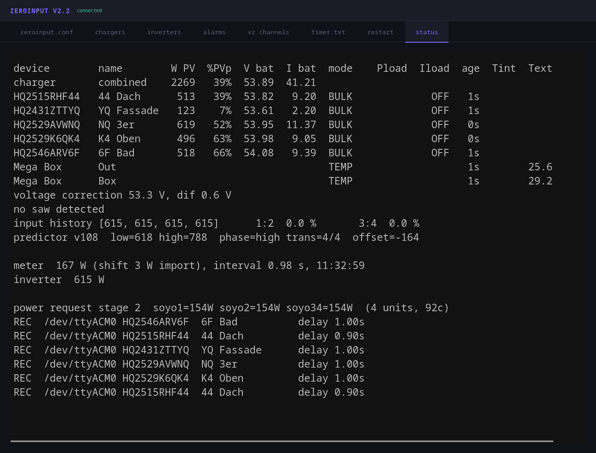
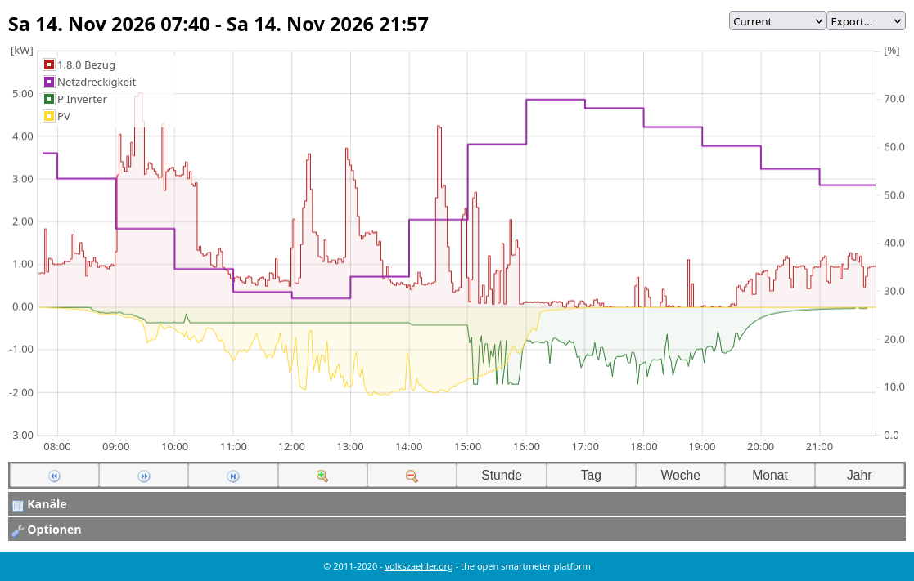

# zeroinput – Vorstellung

zeroinput ist eine Nulleinspeisung für PV-Anlagen mit Akku. Ein Linux-Gerät liest den Stromzähler des Hauses jede Sekunde aus und stellt die Leistung der Netzwechselrichter so nach, dass der Zähler bei null bleibt: Das Haus bezieht nichts aus dem Netz, und es fließt nichts hinein.

Dabei gilt eine feste Reihenfolge. **Zuerst** deckt die PV-Leistung den Verbrauch im Haus. Was **dann** übrig bleibt, lädt den Akku. Reicht die PV nicht, liefert der Akku den Rest. Die Zeitsteuerung kann davon abweichende Vorgaben machen.

## Der Gedanke hinter dem Namen

Der Name steht für zwei Dinge: null Einspeisung ins Stromnetz und null Daten ins Datennetz.

- **Keine Cloud.** Die Regelung läuft vollständig im Haus. Es gibt kein Herstellerkonto, keinen fremden Server und keine App, von der der Betrieb abhängt.
- **Kabel statt Funk.** Zähler, Wechselrichter und Laderegler hängen an seriellen Leitungen. Im Regelkreis gibt es weder WLAN noch Bluetooth, also auch deren Aussetzer und Verzögerungen nicht.
- **Kurzer Weg.** Die Werte gehen ohne MQTT, Broker oder Datenbank direkt vom Zähler zur Regelung. Fällt die Datenbank von volkszaehler.org aus, regelt zeroinput ungestört weiter.

Das Internet brauchen nur die Zusatzprogramme, die Entladezeiten planen. Sie rufen Prognosen und Preise ab und übertragen dabei keine Messwerte der Anlage. Die Regelung selbst hängt nicht von ihnen ab.

## Was man braucht

| Teil | Was passt |
|---|---|
| Stromzähler | Moderne Messeinrichtung mit Lesekopf oder ein anderes Messgerät, das vzlogger auslesen kann. Der Zähler muss den Wert `1-0:16.7.0` liefern, die saldierte Leistung über alle drei Phasen. Ohne diesen Wert ist die Regelung nicht möglich. |
| Rechner | Ein Linux-Gerät mit USB |
| Netzwechselrichter | Soyosource GTN mit RS485-Limiter-Anschluss oder Victron MultiPlus-II mit MK3-USB-Adapter, in beliebiger Mischung und Anzahl |
| Laderegler | eSmart3, Victron MPPT, EPever Tracer, Renogy Rover oder Morningstar TriStar, in beliebiger Mischung und Anzahl |
| Akku | LiFePO4, die Zellzahl ist einstellbar (16S, 15S, 8S und andere) |
| Software | [volkszaehler.org](https://www.volkszaehler.org/) mit vzlogger für die Zählerdaten und die Aufzeichnung |

Elektrisch entspricht der Aufbau einer Inselanlage: PV-Module, Laderegler und Akku bilden die Gleichstromseite, die Netzwechselrichter hängen am Akku und speisen ins Hausnetz ein.

Es werden nur Wechselrichter unterstützt, die im Sekundentakt einen Leistungswert in Watt annehmen und aus einem Akku gespeist werden. Mikro- und String-Wechselrichter lassen sich nur drosseln und reagieren zu langsam. Die Begründung im Einzelnen steht in der [Spezifikation](spec.md).

## Wie die Regelung arbeitet

Der Zähler meldet über vzlogger jede Sekunde die saldierte Leistung des Hauses. zeroinput rechnet daraus die Leistung, die fehlt oder zu viel ist, prüft sie gegen alle Grenzen und schickt den neuen Sollwert an die Wechselrichter. Die Laderegler liefern dazu PV-Leistung und Akkuspannung. Alle Werte gehen zusätzlich an volkszaehler.org und erscheinen dort als Kurven.

Der Zähler saldiert die drei Phasen. Deshalb genügt es, auf einer Phase einzuspeisen, um den Verbrauch auf allen dreien auszugleichen.

In der Praxis schwankt der Zählerwert minimal um die Nulllinie.

## Was die Regelung kann

**Regeln**
- Sollwert im Sekundentakt, mit einstellbarer Mindest- und Höchstleistung
- Rampenmodus für große Lastsprünge
- Erkennen und Dämpfen von Schwingungen im Regelkreis
- Verschieben der Nulllinie in Richtung Bezug oder Einspeisung, fest eingestellt oder automatisch
- [Lastprediktor](predictor_spec.md): erkennt taktende Verbraucher wie Waschmaschine oder Herd und vermeidet die Einspeisung, die ihr Ein- und Ausschalten sonst verursacht

**Wechselrichter**
- Zwei Leistungsstufen: Bei kleiner Last arbeiten nur die Geräte der Grundstufe, bei größerer Last schalten weitere zu
- Gleichmäßige Aufteilung auf alle aktiven Geräte, jedes nur bis zu seiner Höchstleistung
- Prüfung beim Start, ob die Geräte den ganzen Leistungsbereich lückenlos abdecken und ob die eingestellte Höchstleistung zu ihnen passt

**Akku**
- Unterspannungsschutz und sanftes Zurücknehmen der Entladeleistung, bevor der Akku leer ist
- Ausgleich des Spannungsabfalls auf der Leitung zum Akku
- Freie Einspeisung bei vollem Akku, abschaltbar und mit einstellbaren Spannungen
- Hitzeschutz: Ein Temperatursensor nimmt die Leistung stufenlos zurück und schaltet bei Überhitzung ab
- Temperaturalarme je Gerät mit frei wählbarem Befehl

**Zeitsteuerung**
- Eine [Timer-Datei](spec.md#entladetimer) gibt für beliebige Zeitpunkte vor, wie viel Leistung aus dem Akku kommen darf, wie viel der Wechselrichter einspeisen darf und wie viel Energie in dem Zeitraum entnommen werden darf. Ein Beispiel liegt als [`timer.txt.example`](../../timer.txt.example) bei.

Alle Funktionen sind in der [Spezifikation](spec.md) genau beschrieben, der Lastprediktor in einer [eigenen Spezifikation](predictor_spec.md).

## Bedienung im Browser

zeroinput bringt eine optionale [Weboberfläche](spec.md#weboberfläche-webconfigpy) mit, die mit `-httpd` startet. Dort lassen sich Laderegler, Wechselrichter, Alarme, volkszaehler.org-Kanäle, die Timer-Datei und alle übrigen Einstellungen bearbeiten. Die meisten Änderungen wirken sofort, ohne Neustart. Eine Statusseite zeigt die laufenden Werte. zeroinput läuft auch ohne die Weboberfläche, die Einstellungen stehen dann direkt in `zeroinput.conf`.

Weitere Ansichten zeigt die Seite [Screenshots](../screenshots.md).

## Zusatzprogramme

Beide Programme planen, wann der Akku entladen wird, und schreiben dafür die Timer-Datei. Es läuft immer nur eines von beiden.

**dirt_shift** verschiebt die Entladung in die Stunden, in denen der Netzstrom am meisten CO₂ verursacht. Es nutzt dafür die Netzprognose der Energy-Charts-Stromampel (ersatzweise SMARD), die Wetterprognose von Open-Meteo, den eigenen Verbrauch der letzten Tage und den rekonstruierten Akkuinhalt. Auf Wunsch schaltet es eine Wallbox in die saubersten Stunden. Mehr dazu in der [Kurzübersicht](dirt_shift_about.md), der [Installationsanleitung](dirt_shift_installation.md) und der [Spezifikation](dirt_shift_spec.md).

Vormittags bei sauberem Netz (lila, rechte Achse) lädt die PV den Akku, und das Haus bezieht aus dem Netz. Ab 15 Uhr, wenn das Netz am dreckigsten ist, deckt der Akku den Verbrauch, bis er gegen 19:30 Uhr leer ist.

**tibber** legt die Entladung in die teuersten Stunden eines dynamischen Tarifs. Dieser Teil ist im Teststadium, siehe die [Beschreibung](../en/tibber.md).

## Beispiele aus dem Betrieb

Die Kurven stammen aus volkszaehler.org. PV-Leistung (gelb) und Einspeisung (grün) sind nach unten aufgetragen, die Akkuspannung ist rot.

### Guter Tag mit hohem Verbrauch

PV-Erzeugung 7,7 kWh, Einspeisung 7,3 kWh. An diesem Tag liefen Backofen, Mikrowelle, Brunnenpumpe und Klimagerät, am Abend war der Akku leer. Morgens und abends folgt die Einspeisung der PV-Kurve. Gegen 17:30 Uhr nimmt die Regelung die Leistung zurück, weil die Akkuspannung fällt.

### Trüber Tag

Solange die PV weniger liefert, als das Haus braucht, geht die gesamte Leistung direkt in den Wechselrichter. Der Akku wird nicht geladen. Die Anlage verhält sich dann wie ein Modulwechselrichter.

### Waschmaschine in der Heizphase

Die schwarze Kurve ist die saldierte Leistung am Zähler. Oberhalb der Nulllinie ist sie Bezug, unterhalb tatsächliche Einspeisung. In diesem Ausschnitt standen 430 Wh Bezug 12 Wh ungewollte Einspeisung gegenüber. Die Wellen entstehen durch den Trommelmotor, der ständig an- und abläuft: Die Regelung folgt dem Anstieg, und beim plötzlichen Abschalten fließt für einen Moment Leistung ins Netz.

### Der Backofen taktet den Akku leer

Hier arbeiten vier Teile der Regelung zusammen: die Begrenzung der Entladeleistung, der Rampenmodus bei den Lastsprüngen, der Ausgleich des Spannungsabfalls und das Zurücknehmen der Leistung bei fallender Akkuspannung.

### Schwankungen in einer ruhigen Phase

Etwa 150 W Einspeisung. Schwarz ist die Abweichung am Zähler, lila die automatisch verschobene Nulllinie.

## Genauigkeit und Wirkungsgrad

Die Soyosource-Wechselrichter liefern recht genau die angeforderte Leistung. Sie ändern ihre Leistung mit etwa 400 W pro Sekunde, von null auf volle Leistung vergehen also gut zwei Sekunden. Mehrere Geräte werden parallel angesteuert und reagieren zusammen entsprechend schneller.

Im Beispiel oben wurden aus 7,7 kWh PV-Erzeugung 7,3 kWh Einspeisung, das sind etwa 95 %. Je mehr Energie den Umweg über den Akku nimmt, desto niedriger liegt der Wert.

## Hinweise zur Hardware

- Die harten Grenzen für Unter- und Überspannung des Akkus gehören in jeden Laderegler und jeden Wechselrichter. zeroinput arbeitet innerhalb dieser Grenzen und ersetzt sie nicht.

## Rechtliches

Dieser Abschnitt ist eine Einschätzung und keine Rechtsberatung.

Nach meinem Verständnis ist eine Anlage dieser Art in Deutschland in jedem Fall anmeldepflichtig im Marktstammdatenregister und je nach Leistung auch beim Netzbetreiber.

Am Stromnetz betrieben werden dürfen nur Wechselrichter mit einem Zertifikat nach VDE-AR-N 4105. Für den Victron MultiPlus-II liegt dieses [Zertifikat](https://www.victronenergy.com/upload/documents/Certificate-VDE-AR-N-4105-2018-11-EZE-MultiPlus-II-%28GX%29-24V-3k%2C-48V-3k-4k5-5k-6k5.pdf) vor, eingestellt auf den Netzcode für Deutschland. Für den Soyosource GTN ist mir kein Zertifikat bekannt. Ob er in Deutschland am Netz betrieben werden darf, ist daher unsicher.

## Weiter

- [Installationsanleitung](installation.md)
- [Spezifikation](spec.md)
- [Lastprediktor](predictor_spec.md)
- dirt_shift: [Kurzübersicht](dirt_shift_about.md), [Installationsanleitung](dirt_shift_installation.md), [Spezifikation](dirt_shift_spec.md)
- [Screenshots der Weboberfläche](../screenshots.md)
- Austausch und Fragen: [Akku Doktor Forum](https://akkudoktor.net/t/zeroinput-skalierbare-nulleinspeisung-mit-volkszaehler-monitor/5031), [photovoltaikforum](https://www.photovoltaikforum.com/thread/179609-nulleinspeisung-mit-mme-volkszaehler-soyosource-gti-esmart3-laderegler-akku-sald/)
