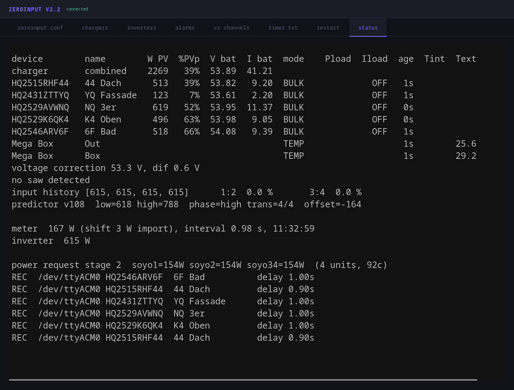
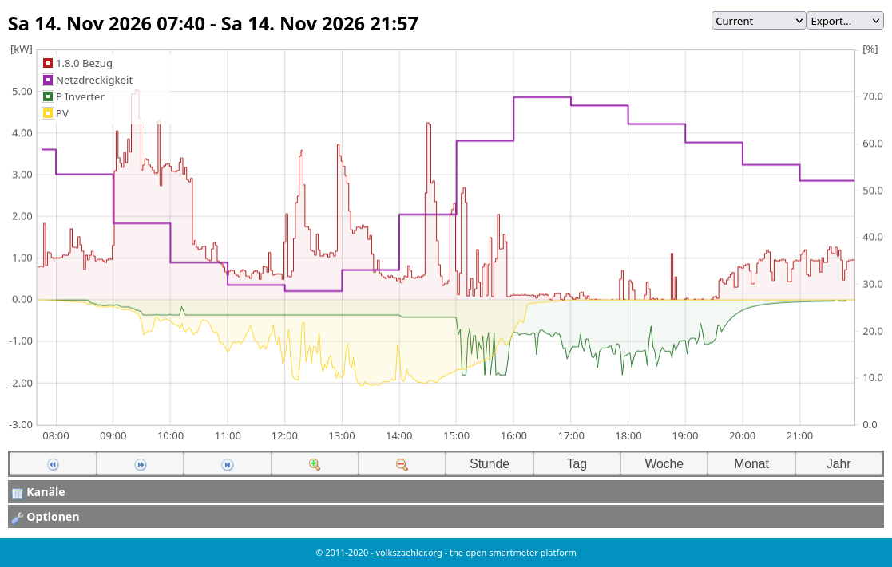

# zeroinput – Introduction

zeroinput is a zero export control for PV systems with a battery. A Linux device reads the house electricity meter every second and adjusts the power of the grid-tie inverters so that the meter stays at zero: the house draws nothing from the grid, and nothing flows into it.

A fixed order applies. **First**, the PV power covers the consumption in the house. Whatever is left **after that** charges the battery. If the PV is not enough, the battery supplies the rest. The timer can set different rules.

## The idea behind the name

The name stands for two things: zero input into the power grid and zero data into the data network.

- **No cloud.** The control runs entirely in the house. There is no manufacturer account, no third-party server and no app the operation depends on.
- **Cables instead of radio.** Meter, inverters and charge controllers are connected by serial lines. The control loop uses neither WiFi nor Bluetooth, and so none of their dropouts and delays.
- **Short path.** Values go from the meter to the control directly, without MQTT, broker or database. If the volkszähler database fails, zeroinput keeps controlling undisturbed.

Only the add-ons that plan discharge times need the internet. They fetch forecasts and prices and do not transmit any measurements of the system. The control itself does not depend on them.

## What you need

| Part | What fits |
|---|---|
| Electricity meter | Smart meter with an optical reading head, or another meter that vzlogger can read. The meter must provide the value `1-0:16.7.0`, the net power balanced over all three phases. Without this value the control is not possible. |
| Computer | A Linux device with USB |
| Grid-tie inverters | Soyosource GTN with RS485 limiter port or Victron MultiPlus with MK3-USB adapter, in any mix and number |
| Charge controllers | eSmart3, Victron MPPT, EPever Tracer, Renogy Rover or Morningstar TriStar, in any mix and number |
| Battery | LiFePO4, the cell count is configurable (16S, 15S, 8S and others) |
| Software | [volkszähler](https://www.volkszaehler.org/) with vzlogger for the meter data and the recording |

Electrically the setup is that of an off-grid system: PV modules, charge controllers and battery form the DC side, the grid-tie inverters are connected to the battery and feed into the house wiring.

Only inverters that accept a power value in watts every second and are supplied from a battery are supported. Micro and string inverters can only be throttled and react too slowly. The detailed reasoning is in the [specification](spec.md).

## How the control works

Through vzlogger the meter reports the net power of the house every second. zeroinput calculates the power that is missing or too much, checks it against all limits and sends the new setpoint to the inverters. The charge controllers add PV power and battery voltage. All values also go to the volkszähler and appear there as curves.

The meter balances the three phases. Feeding in on one phase is therefore enough to offset the consumption on all three.

In practice the meter value fluctuates minimally around the zero line.

## What the control can do

**Control**
- Setpoint every second, with adjustable minimum and maximum power
- Ramp mode for large load steps
- Detection and damping of oscillation in the control loop
- Shifting the zero line towards import or export, fixed or automatic
- [Load predictor](predictor_spec.md): detects cycling loads such as a washing machine or a stove and avoids the export their switching on and off would otherwise cause

**Inverters**
- Two power stages: at low load only the devices of the base stage work, at higher load more are added
- Even distribution across all active devices, each only up to its maximum power
- Check at startup whether the devices cover the whole power range without gaps and whether the configured maximum power matches them

**Battery**
- Undervoltage protection and gentle reduction of the discharge power before the battery is empty
- Compensation of the voltage drop on the line to the battery
- Free export with a full battery, optional and with configurable voltages
- Heat protection: a temperature sensor reduces the power continuously and switches off on overheating
- Temperature alarms per device with a freely chosen command

**Scheduling**
- A [timer file](spec.md#discharge-timer) sets, for any points in time, how much power may come from the battery, how much the inverter may feed in and how much energy may be drawn in that period. An example is included as [`timer.txt.example`](../../timer.txt.example).

All functions are described in detail in the [specification](spec.md), the load predictor in a [specification of its own](predictor_spec.md).

## Operation in the browser

zeroinput comes with an optional [web interface](spec.md#web-interface-webconfigpy), started with `-httpd`. It edits charge controllers, inverters, alarms, volkszähler channels, the timer file and all other settings. Most changes take effect immediately, without a restart. A status page shows the live values. zeroinput also runs without the web interface; the settings are then edited directly in `zeroinput.conf`.

More views are on the [screenshots](../screenshots.md) page.

## Add-ons

Both programs plan when the battery is discharged and write the timer file for it. Only one of them runs at a time.

**dirt_shift** shifts the discharge into the hours in which grid power causes the most CO₂. It uses the forecasts of SMARD and Open-Meteo, the own consumption of the last days and the reconstructed battery content. Optionally it switches a wallbox into the cleanest hours. More in the [overview](dirt_shift_about.md), the [installation guide](dirt_shift_installation.md) and the [specification](dirt_shift_spec.md).

In the morning, with a clean grid (purple, right axis), the PV charges the battery and the house draws from the grid. From 3 pm, when the grid is dirtiest, the battery covers the consumption until it is empty at about 7:30 pm.

**tibber** puts the discharge into the most expensive hours of a dynamic tariff. This part is in testing, see the [description](tibber.md).

## Examples from operation

The curves come from the volkszähler. PV power (yellow) and feed-in (green) are plotted downwards, the battery voltage is red.

### Good day with high consumption

Two Soyosource. PV generation 7.7 kWh, feed-in 7.3 kWh. On this day oven, microwave, well pump and air conditioner were running, in the evening the battery was empty. In the morning and evening the feed-in follows the PV curve. At about 5:30 pm the control reduces the power because the battery voltage drops.

### Cloudy day

As long as the PV delivers less than the house needs, all of its power goes straight into the inverter. The battery is not charged. The system then behaves like a module inverter.

### Washing machine in the heating phase

Two Soyosource. The black curve is the net power at the meter. Above the zero line it is import, below it actual export. In this section 430 Wh of import faced 12 Wh of unwanted export. The waves come from the drum motor, which keeps starting and stopping: the control follows the rise, and when the motor stops suddenly, power flows into the grid for a moment.

### The oven cycles the battery empty

Three Soyosource. Four parts of the control work together here: the limit of the discharge power, the ramp mode on the load steps, the voltage drop compensation and the power reduction with falling battery voltage.

### Fluctuations in a quiet phase

One inverter, about 150 W feed-in. Black is the deviation at the meter, purple the automatically shifted zero line.

## Accuracy and efficiency

The Soyosource inverters deliver the requested power quite accurately. They change their power at about 400 W per second, so going from zero to full power takes a little over two seconds. Several devices are driven in parallel and together react correspondingly faster.

In the example above, 7.7 kWh of PV generation became 7.3 kWh of feed-in, about 95 %. The more energy takes the detour through the battery, the lower the value.

## Hardware notes

- The hard limits for battery undervoltage and overvoltage belong in every charge controller and every inverter. zeroinput works within these limits and does not replace them.
- The Soyosource GTN 1200 delivers at most 900 W in battery mode.

## Legal

This section is an assessment, not legal advice.

As I understand it, a system of this kind must be registered in Germany with the grid operator and in the Marktstammdatenregister. To my knowledge there is no certificate according to VDE-AR-N 4105 for the Soyosource GTN. Without this certificate the device must not be operated on the grid in Germany. Other countries have their own rules.

## Further reading

- [Installation guide](installation.md)
- [Specification](spec.md)
- [Load predictor](predictor_spec.md)
- dirt_shift: [overview](dirt_shift_about.md), [installation guide](dirt_shift_installation.md), [specification](dirt_shift_spec.md)
- [Screenshots of the web interface](../screenshots.md)
- Discussion and questions (German): [Akku Doktor forum](https://akkudoktor.net/t/skalierbare-high-end-cheap-tech-nulleinspeisung-mit-volkszaehler-monitor-und-tibber-integration/5031), [photovoltaikforum](https://www.photovoltaikforum.com/thread/179609-nulleinspeisung-mit-mme-volkszaehler-soyosource-gti-esmart3-laderegler-akku-sald/)
