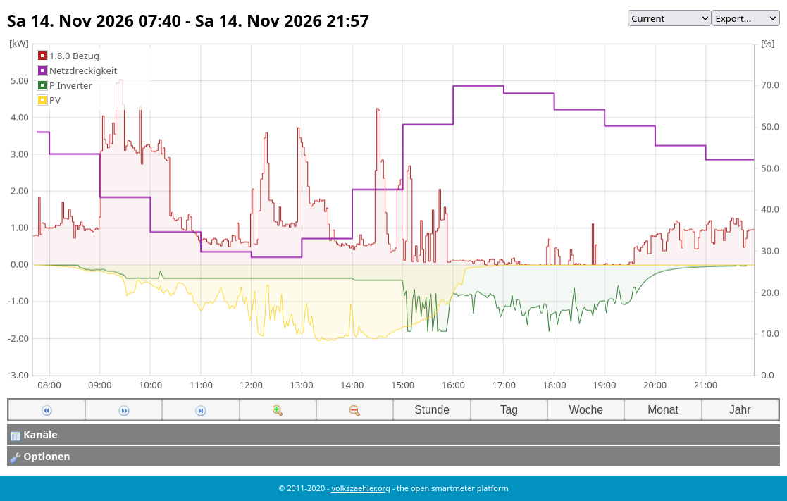

# dirt_shift — Overview
*v2.1*

## Purpose

`dirt_shift` shifts the discharge of a PV home battery into the grid hours with the highest
CO₂ intensity. The German electricity mix is dirty in the evening, at night, and in the early
morning (little PV, high load, fossil peaking plants) and clean during the day. Being able to
choose *when* the battery covers consumption instead of the grid saves the most emissions in
the dirtiest hours. `dirt_shift` therefore steers the available battery content into exactly
those hours.

The program does not control the battery itself: every fifteen minutes it writes a `timer.txt`,
which **zeroinput** reads and acts on. PV pass-through to the house is left untouched as a rule
— only battery discharge is limited. The only thing `dirt_shift` switches directly is the
optional wallbox.

## Data basis

Every run brings together: the **house load** (7-day average from [volkszaehler.org](https://volkszaehler.org/)), the current
**battery content** (reconstructed from charge/discharge energy since the last sustained empty
state, hardened against brief voltage outliers and sensor faults), the **PV forecast**
(empirical system curve, scaled by Open-Meteo's radiation forecast), and the **grid CO₂
intensity** (the renewable share of load from the Energy-Charts power signal, with SMARD's
day-ahead forecast as the fallback). Missing data is cushioned in stages: if the power signal
fails, SMARD steps in; if SMARD's load forecast is missing, the most recent available day's
profile substitutes for it; if both sources fail, a cache bridges one day, provided it holds a
forecast for today. If even that is not enough, an
**emergency mode** models a relative dirtiness curve from solar and wind forecasts (Open-Meteo)
together with a fixed nationwide load profile — clearly flagged, never mistaken for real data.
Only when even the weather cannot be fetched does `dirt_shift` leave an "all-allowed" timer
behind, so zeroinput is never blocked by a stale limit. A reconstructed battery content that
falls physically impossibly below "empty" independently triggers a warning that roughly
distinguishes a faulty component (e.g. an inverter that requests power but does not deliver it)
from a conversion efficiency set too low.

## Red and green zones

Each hour's ratio of renewable generation to load yields a dirtiness value. Its median is taken
over the rolling 24-hour window starting at the current hour: the cleaner half becomes **green**,
the dirtier half **red**. The cut thus adapts to the actual spread instead of hanging on a fixed
threshold.

## Discharge control

A **reserve** is held back — the demand of the coming red hours up to the next PV charging
phase, minus the surplus expected before then (on a sunny day the battery fills itself anyway,
so the reserve is zero). The mode for each hour follows from that:

- **green, content above the reserve** → free discharge.
- **green, content below it** → no discharge (the house runs off the grid), so the content stays
  available for the dirty hours — but only if those are noticeably dirtier than the current hour
  and the coming surplus would not overfill the battery; otherwise the battery keeps covering the
  running consumption.
- **red** → free discharge if the content suffices; otherwise capped to the house's share, with
  the single dirtiest hour of the window served without limit.

The cap works two ways: as a power limit (watts) and as an energy budget per quarter hour
(measured against the actually measured PV). That pushes both a brief load spike and a
sustained higher load onto the grid instead of the battery.

## A day in operation

<picture>
	<source media="(prefers-color-scheme: dark)" srcset="../screenshots/dirt_shift_day_dark.png">
	
</picture>

A Saturday in November, recorded in volkszaehler.org. Purple is the grid dirtiness (right axis), red the grid import, yellow the PV power and green the feed-in of the inverters; PV and feed-in are plotted downwards. Precharge was active with `round_trip_margin` 1.

- **Morning and midday, dirtiness 30–45 %:** The grid is clean. The feed-in stays throttled to a small part of the PV power (precharge), the rest of the PV charges the battery. During this time the house draws its power from the grid.
- **From 3 pm, dirtiness 60–68 %:** The grid is at its dirtiest. The battery discharges freely, the feed-in follows the consumption, and the grid import is zero.
- **From about 7:30 pm:** The battery is empty, the feed-in fades out, and the house draws from the grid again.

The energy stored in the battery thus replaces grid power in the dirtiest hours of the day instead of the cleanest.

## Optional extra features

**Wallbox.** `dirt_shift` can switch a wallbox's relay via a Tasmota device whenever one of
three — mutually independent — conditions holds: the hour ranks among the cleanest of the
window, the battery has surplus above its reserve, or the battery is full while PV
is producing surplus. If the reading a path
needs is missing (e.g. the battery content), only that path drops out; the others keep deciding.
Only if none of the three can decide is the relay left unchanged. A car has to be charged from
the grid one way or another — the point is to pick the cleanest hour for it. If the wallbox is
charging via the cleanliness path while the battery does not cover its reserve and has no
surplus either, its discharge is capped to the house's share, so the charging current comes from
the grid rather than draining the overnight reserve. Only a relay `dirt_shift` switched on itself
is switched off again; a manual charge is left alone. The wallbox is controlled even while the
timer is disabled.

**Precharge.** In the cleanest hours, PV can be steered into the battery instead of the house;
the house then imports from the grid during that clean hour, so more charge is available for the dirty
hours later. That costs the round-trip loss and only pays off while the battery would not fill
up anyway — on windy, dull days rather than sunny ones. The `round_trip_margin` setting decides
how clear the CO₂ gain must be: close to 1 as clean as possible, larger more economical. Precharge uses real grid data only and is off in
emergency mode. Inverter pass-through is never throttled all the way to 0, so zeroinput always recognises the timer line
as valid.

## Operation

Invoked every fifteen minutes via cron. `-v` shows zone, battery level, reserve and mode;
`-debug` additionally shows the hourly overview table. All installation-specific values live in
`dirt_shift.conf`; shared values are read by `dirt_shift` from `zeroinput.conf` without being
changed there. Once a day, `dirt_shift` also writes `pv_forecast.json` with the day's total PV
forecast in kWh — a pure side output for the
[Ortsnetz-Auslastung](https://github.com/thomaslehmann1234/datenerfassung-ortsnetz-auslastung)
project, with no effect on `dirt_shift`'s own control.
